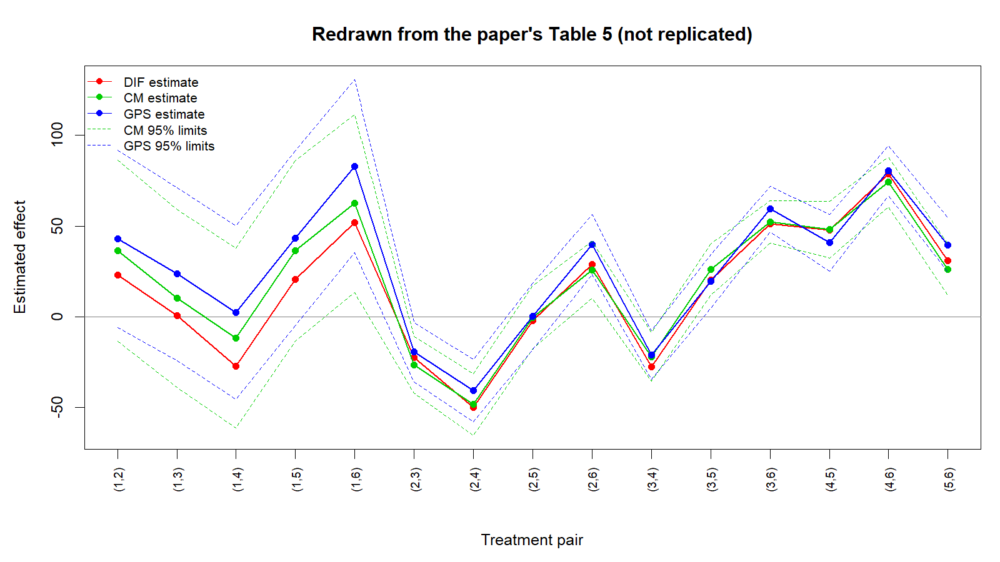
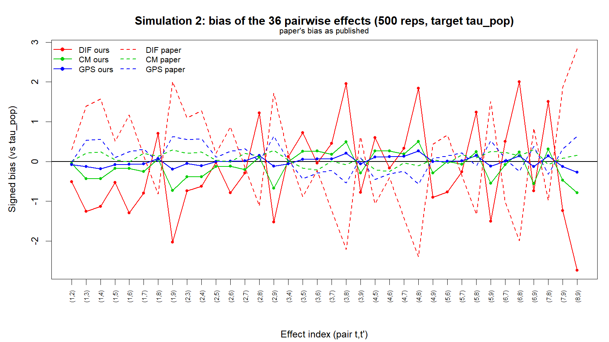
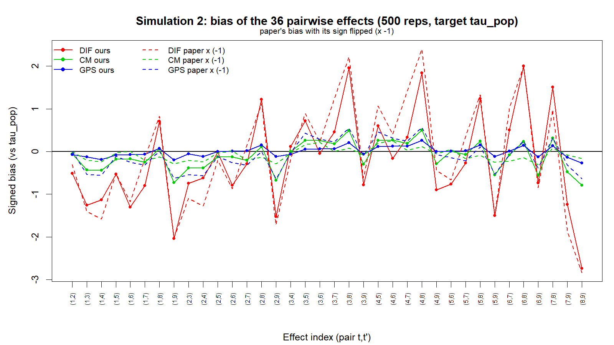
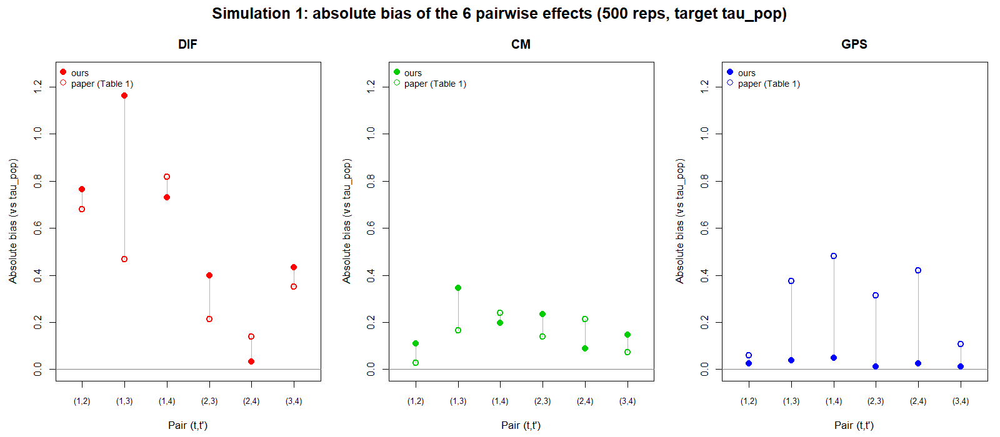
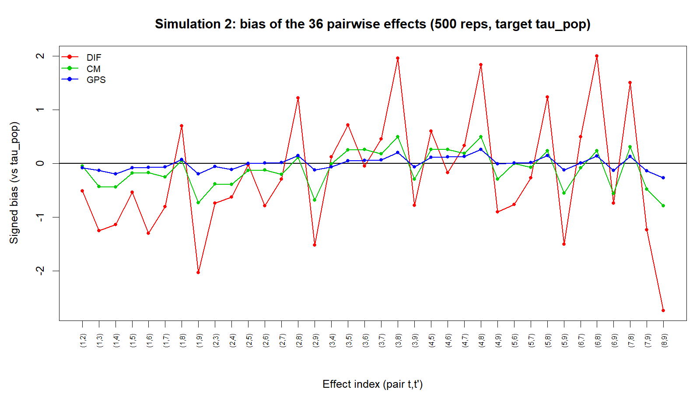
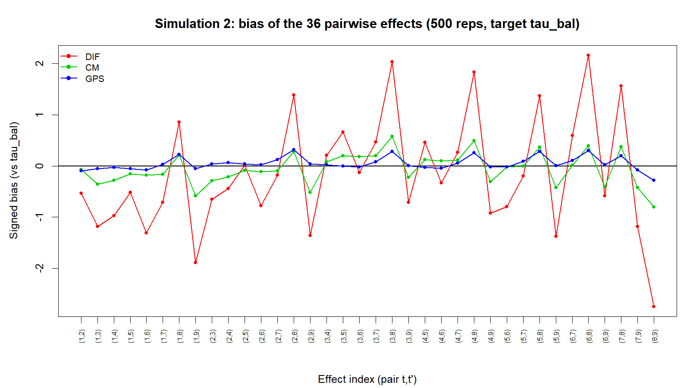

# Generalized propensity score and covariate matching for multilevel treatments in hierarchical data: Rebuilding Guo, Liu, and Wang (2022) in R

Qiu Wang, Syracuse University · v1.0 · November 2026

## Key findings

Guo, Liu and Wang (2022) proposed covariate matching (CM) and generalized propensity score (GPS) matching to estimate pairwise effects across multilevel treatment combinations, and reported simulations showing that both reduce the bias of the raw group difference.

- **Published vs rebuilt.** The rebuild, written from the paper's text alone without the original code, confirms the paper's central claim: both matching methods remove most of the raw-difference bias. Mean absolute bias falls from 0.6–0.9 (raw difference) to 0.2–0.3 (CM) and 0.03–0.10 (GPS).
- **GPS does better than published.** In the rebuild, GPS matching has the smallest bias of the three estimators in both simulations, and in Simulation 1 it is nearly unbiased (mean absolute bias 0.026, against 0.29 in the paper's Table 1).
- **Thirteen decisions, documented.** Rebuilding from the published text alone, as any reader without the original code must, requires thirteen decisions (D1–D13). Each default follows the paper's description or is a reasoned reading of it, and is recorded in [docs/spec.md](docs/spec.md). One of them, the reading of Eq. (4) (D7), accounts for about half of the GPS gap; the remaining differences depend on details not reported in the paper.
- **The method stands.** The paper's estimators are implemented unchanged. CM is more efficient, with about half GPS's mean squared error, and GPS is less biased: a bias–variance trade-off. Not every number improves: CM coverage in Simulation 1 is lower than published (83–95% against 92–98%). The rebuild offers no evidence against using GPS matching for multilevel treatments in the setting the paper considers.

## Why this replication

The paper offers estimators for treatment effects when students are nested in schools, but it provides no code or data and leaves several simulation details unspecified. This rebuild checks which reported results hold up, documents the choices needed to run it (D1–D13), and serves as a baseline for extending matching to clustered multilevel data.

## Background

Everything here was written from the published description, without the original code. The paper itself is not stored in this repository:

> Guo, S., Liu, J., & Wang, Q. (2022). Effective learning during COVID-19: Multilevel covariates matching and propensity score matching. *Annals of Data Science, 9*(5), 967–982. https://doi.org/10.1007/s40745-022-00392-x

Individual-level covariates X and school-level covariates Z are combined with treatments at two levels; every combination of the two treatment levels is one treatment group, so the problem becomes a comparison of A groups and all A(A − 1)/2 pairwise effects.

The paper's application (Section 6), redrawn from its Table 5. Not replicated: the paper does not describe how those data were generated.

**How the paper handles the hierarchy.** The paper's setting is hierarchical, with students nested in schools and a treatment at each level, but its estimation is single-level:

- **Treatment.** The student-level and school-level treatments are combined into one multi-valued treatment, T = 1, …, A; Section 4 treats the problem as a multiple-treatment case.
- **Matching.** Both methods match across all units on student covariates X and school covariates Z. Cluster membership is not used: there are no cluster IDs, random effects or within-school matching. Without Z, the methods reduce to those of Yang et al. (2016) for multi-level treatments in non-hierarchical data.
- **Simulations.** Z is drawn separately for each unit, so the simulated data are not nested in schools.

This rebuild follows the paper's design. Matching that uses the clustering, such as matching within schools first, is left for future work.

## Design (as in Section 5)

- **Covariates.** X = (X1, …, X4) ~ multivariate normal with the paper's covariance matrix; Z1 ~ Uniform(−3, 3) (D2), Z2 ~ χ²(1), Z3 ~ Bernoulli(0.5).
- **Treatment.** Multinomial logit with η₁ = 0 and η_t = 0.1 × a sum of linear and squared covariate terms (D1). Simulation 1 has A = 4 groups of 100 units (6 effects); Simulation 2 has A = 9 groups of 200 units (36 effects).
- **Outcomes.** Y(t) is linear in (X, Z) with group-specific coefficients, plus N(0, 1) noise.
- **Estimators.** DIF, the raw difference in group means; CM, one Mahalanobis nearest neighbour with replacement on all 7 covariates; GPS, one nearest neighbour on the score from a linear multinomial logit (misspecified on purpose).
- **Inference.** Percentile bootstrap, B = 200, resampling within treatment groups and refitting the GPS model each time (D8).
- **Scale.** 500 replications per simulation. Bias, MSE and coverage are reported against two truths: the population ATE (τ\_pop) and the balanced-design ATE (τ\_bal) (D4, D9).

The full set-up is in [`docs/spec.md`](docs/spec.md).

## What differed

The paper leaves thirteen points open or inconsistent. The rebuild documents a choice for each in [`docs/spec.md`](docs/spec.md) (D1–D13). The ones that matter most:

1. **Treatment probabilities (D1).** The printed denominator, 1 + Σ exp(η), makes the probabilities sum to less than 1. We use the standard multinomial logit.
2. **Z1 (D2).** "N[−3, 3]" is read as Uniform(−3, 3).
3. **Fixed group sizes (D3, D9).** Units are drawn from a large pool by the multinomial probabilities and the first 100 or 200 per group are kept. This sample is not drawn from the population, so CM and GPS estimate the balanced-design ATE; both truths are reported.
4. **Covariance matrix for matching (D6).** The paper builds it from X only but matches on X and Z; we use all 7 covariates.
5. **Eq. (4) (D7, D13).** The printed formula uses the score for t in both terms. The main GPS uses the score for t′ in the second term; the literal reading is reported as a sensitivity check in [`docs/sensitivity.md`](docs/sensitivity.md). In Simulation 1, reading Eq. (4) literally, as printed, raises the mean absolute GPS bias from 0.026 to 0.159, about half the way to the published 0.293. This is consistent with the published figures reflecting, at least in part, the literal reading. The original simulation code was not available for this rebuild, and the published text alone does not settle which reading was used.

<table>
  <tr>
    <td></td>
    <td></td>
  </tr>
  <tr>
    <td align="center">As published</td>
    <td align="center">Sign flipped</td>
  </tr>
</table>

The sign of bias is a further difference. Our bias (solid) is the mean estimate minus the truth; the paper's Table 3 values (dashed) mirror ours as published (left) and line up once multiplied by −1 (right). The paper does not state its convention; see [docs/two_way.md](docs/two_way.md).

Absolute bias of the 6 Simulation 1 effects: rebuild (filled) vs the paper's Table 1 (open), against τ\_pop.

## Two targets: τ_pop and τ_bal

Every bias figure here compares an estimate with a true effect, and this design admits two natural truths.

- **Population ATE, τ_pop.** The average effect of treatment t versus t′ over the whole population, as in the paper's Eq. (1). This is the usual average treatment effect (ATE) in propensity score analysis.

$$\tau_{pop}(t,t') = E\left[\,Y(t) - Y(t')\,\right]$$

- **Balanced-design ATE, τ_bal.** The simulations keep a fixed number of units in every treatment group (100 or 200), however rare the group is in the population. The analysed sample is then an equal-weight mix of the groups, and estimators that average over the sample's units target the effect over that mix:

$$\tau_{bal}(t,t') = \frac{1}{A}\sum_{s=1}^{A} E\left[\,Y(t) - Y(t') \mid T = s\,\right]$$

<table>
  <tr>
    <td></td>
    <td></td>
  </tr>
  <tr>
    <td align="center">against τ_pop</td>
    <td align="center">against τ_bal</td>
  </tr>
</table>

The same 36 Simulation 2 effects, measured against the two truths.

The two coincide when every treatment group is equally common, or when the effect is the same for everyone. Neither holds here: in Simulation 2 the groups make up 6% to 19% of the population and effects vary with covariates, so the two truths differ by up to 0.18.

**In a real study.** Suppose a district evaluates learning modes by drawing 200 students from each combination of learning mode and school region, including rare ones. An estimator that averages over those students estimates the effect for that over-represented mix, not for the district's student body. Recovering the district-wide effect requires weighting each group by how common it is in the population.

**In propensity score terms.** Choosing a truth means choosing the target population, as with the ATE versus the effect on the treated (ATT) in binary-treatment analyses, or with trimming to improve overlap, which also changes whose effect is estimated (Crump et al., 2009). We report bias against both; the paper's definition, τ_pop, is primary.

## Results

Mean absolute bias (95% CI coverage), averaged over pairs. Per-pair values are in [results/summary.md](results/summary.md); the full comparison with the paper is in [docs/replication_verdict.md](docs/replication_verdict.md), and pair-by-pair tables against the paper's Tables 1 and 3 are in [docs/two_way.md](docs/two_way.md).

| Estimator | Sim 1, vs τ\_pop | Sim 1, vs τ\_bal | Sim 2, vs τ\_pop | Sim 2, vs τ\_bal |
| --- | --- | --- | --- | --- |
| DIF | 0.588 (85%) | 0.612 (84%) | 0.941 (78%) | 0.927 (79%) |
| CM | 0.187 (91%) | 0.223 (90%) | 0.295 (78%) | 0.262 (81%) |
| GPS | 0.026 (100%) | 0.072 (100%) | 0.099 (100%) | 0.096 (100%) |

- **Efficiency.** GPS has about twice CM's MSE (against τ\_pop: 0.68 vs 0.36 in Simulation 1, 0.63 vs 0.29 in Simulation 2), and its intervals are about 30% too wide, which gives its 100% coverage.
- **Against the paper.** Simulation 1 GPS bias averages 0.026 here and 0.29 in the paper's Table 1. In Simulation 2 our bias tracks Table 3 with the opposite sign (correlations −0.95, −0.76 and −0.87 for DIF, CM and GPS).
- **Sensitivity (D13).** Reading Eq. (4) literally raises the Simulation 1 GPS bias to 0.159, about half the way to the paper's value.

Bias of the 36 Simulation 2 effects in the rebuild, against τ\_pop (red DIF, green CM, blue GPS).

What the figure shows: DIF swings widely across the 36 effects (−2.74 to 2.00), CM less (−0.79 to 0.50), and GPS stays close to zero (−0.27 to 0.26). Against the paper (bias against τ\_pop), our DIF tracks the paper's sign-flipped values closely (see the overlays under What differed and the note on sign in [docs/two_way.md](docs/two_way.md)), but the paper's GPS bias is larger than ours in 31 of 36 pairs (mean absolute bias 0.307 vs 0.099), while its CM bias is smaller (0.139 vs 0.295).

## Reproduce

From the repository root (R 4.5; packages MASS and nnet):

| Step | Command | Time |
|---|---|---|
| 0. True effects (needed by the summaries) | `Rscript R/check_truth.R` | about 1 min |
| (optional) Tests | `Rscript R/test_estimators.R` (`quick` for unit tests only) | about 6 min |
| 1. Simulations 1 and 2, then summaries | `Rscript R/run_all.R` (options: `R=500 B=200 workers=10`) | On 10 workers: Simulation 1 about 15 min, Simulation 2 about 4 h 48 min, full run about 5 h (log: 14m28s, 4h48m19s, 5h03m08s) |
| 2. Rebuild summaries only | `Rscript R/summarize.R` | seconds |
| 3. Figures and comparisons | `Rscript R/plots.R` | seconds |
| 4. D13 sensitivity (Simulation 1) | `Rscript R/run_gps_literal.R`, then `Rscript R/run_gps_literal2.R` (`check` runs the self-tests) | |

Each replication is saved to `results/reps/simK/rep_###.rds` when it finishes. Re-running `run_all.R` skips replications that are already done, so an interrupted run resumes where it stopped. It refuses to mix checkpoints made with different settings (R, B, seed, optimizer tolerance). Progress goes to standard output; redirect it to `results/run_log.txt` for a background run.

Each replication uses its own pre-generated L'Ecuyer-CMRG random-number stream, so results do not depend on the number of workers or the order in which replications run. The scripts use only base R, `parallel` and `nnet`, plus `MASS` for data generation. The R version and session details of the full run are in `results/run_session_info.txt`; the `nnet` and `MASS` versions used (7.3.20 and 7.3.65) are on the second line of `results/run_log.txt`. No `renv` lockfile is included.

## Files

### Start here

[README.md](README.md) gives the overview. [docs/replication_verdict.md](docs/replication_verdict.md) says what replicates and what does not, and [docs/two_way.md](docs/two_way.md) sets our numbers beside the paper's Tables 1 and 3, pair by pair.

### Design and decisions

[docs/spec.md](docs/spec.md) is the full simulation specification, with the thirteen decisions D1–D13. [docs/sensitivity.md](docs/sensitivity.md) reports the D13 check, which reads Eq. (4) literally (Simulation 1 only).

### Code

R scripts in the R/ folder, run from the repository root; the order is under Reproduce above.

R scripts by role (13 files)

- **Data generation:** [R/dgp.R](R/dgp.R) (covariates, treatment probabilities, outcomes, true effects); [R/check_truth.R](R/check_truth.R) (computes and saves the true effects).
- **Estimators:** [R/estimators.R](R/estimators.R) (DIF, CM, GPS and the bootstrap); [R/gps_literal.R](R/gps_literal.R) and [R/gps_literal2.R](R/gps_literal2.R) (the D13 variants GPS_lit and GPS_lit2).
- **Runners:** [R/replicate.R](R/replicate.R) (one replication, with its own random-number stream); [R/run_sim.R](R/run_sim.R) (parallel runs with checkpoints); [R/run_all.R](R/run_all.R) (both simulations, then the summaries); [R/run_gps_literal.R](R/run_gps_literal.R) and [R/run_gps_literal2.R](R/run_gps_literal2.R) (paired D13 runs and their self-tests).
- **Summaries and plots:** [R/summarize.R](R/summarize.R) (summary and comparison CSVs); [R/plots.R](R/plots.R) (figures and the Simulation 2 comparison).
- **Tests:** [R/test_estimators.R](R/test_estimators.R) (unit and integration tests).

### Results

[results/summary.md](results/summary.md) has compact per-pair tables. The figures, the CSVs for each simulation and the sensitivity CSVs are listed below.

Figures, CSVs and run records (19 files)

- **Figures:** [results/fig1_bias_sim2_pop.png](results/fig1_bias_sim2_pop.png) and [results/fig1_bias_sim2_bal.png](results/fig1_bias_sim2_bal.png) (signed bias of the 36 Simulation 2 effects, against τ\_pop and τ\_bal); [results/fig1_bias_sim2_pop_vs_paper.png](results/fig1_bias_sim2_pop_vs_paper.png) and [results/fig1_bias_sim2_pop_vs_paper_flipped.png](results/fig1_bias_sim2_pop_vs_paper_flipped.png) (the same with the paper's values overlaid, as published and multiplied by −1); [results/fig_sim1_abs_bias_vs_paper.png](results/fig_sim1_abs_bias_vs_paper.png) (absolute bias of the 6 Simulation 1 effects, ours vs the paper's Table 1); [results/fig2_table5_redrawn.png](results/fig2_table5_redrawn.png) (the paper's Table 5 redrawn, not replicated).
- **Simulation 1 CSVs:** [results/true_effects_sim1.csv](results/true_effects_sim1.csv) (τ\_pop and τ\_bal per pair); [results/sim1_summary.csv](results/sim1_summary.csv) (bias, SD, MSE, coverage and CI width per estimator, pair and target); [results/sim1_diagnostics.csv](results/sim1_diagnostics.csv) (per replication: run time, GPS convergence, matching distances); [results/sim1_vs_paper.csv](results/sim1_vs_paper.csv) (against the paper's Table 1).
- **Simulation 2 CSVs:** [results/true_effects_sim2.csv](results/true_effects_sim2.csv); [results/sim2_summary.csv](results/sim2_summary.csv); [results/sim2_diagnostics.csv](results/sim2_diagnostics.csv); [results/sim2_vs_paper.csv](results/sim2_vs_paper.csv) (against the paper's Table 3); [results/sim2_bias_correlations.csv](results/sim2_bias_correlations.csv) (correlation with the paper's bias, as published and flipped).
- **Sensitivity CSVs (D13):** [results/gps_literal_sim1.csv](results/gps_literal_sim1.csv) (GPS against GPS_lit); [results/gps_literal2_sim1.csv](results/gps_literal2_sim1.csv) (GPS, GPS_lit and GPS_lit2).
- **Run records:** [results/run_log.txt](results/run_log.txt) and [results/run_session_info.txt](results/run_session_info.txt) (log and `sessionInfo()` of the full run).

Per-replication checkpoints (results/reps/, results/reps_gps_literal/, results/reps_gps_literal2/) are local only, not in the repo.

### Published values

[results/paper_table1.csv](results/paper_table1.csv), [results/paper_table3.csv](results/paper_table3.csv) and [results/paper_table5.csv](results/paper_table5.csv) hold values transcribed from the paper's published tables, for comparison only. The paper's PDF is not included.

### Project files

[LICENSE](LICENSE) (MIT), [CITATION.cff](CITATION.cff) (citation metadata) and [.gitignore](.gitignore) (keeps checkpoints, PDFs and local files out of the repo).

## Lesson

The GPS model's fitting tolerance matters when matching on fitted probabilities. With `nnet::multinom`'s defaults (reltol = 1e-8, maxit = 100), the fitted probabilities were not precise enough for the very small matching distances, and the GPS estimate depended on the optimizer's starting point. Fitting at reltol = 1e-14 with maxit = 10000 (D5) removed this, and a test now checks it.

## Conclusions

In these simulations, covariate matching and GPS matching both remove most of the bias in the raw group difference, as the paper reports. GPS had the smallest bias and CM the smallest mean squared error, so the better choice depends on whether bias or variance matters more. The published numbers cannot be reproduced exactly from the paper alone, because thirteen points are left open; reading Eq. (4) literally accounts for about half of the GPS discrepancy. These results are a baseline for extending the comparison to clustered, multilevel data.

## Acknowledgment

This is a re-implementation, written from the published description of Guo, Liu & Wang (2022). The original authors' code was not used.

Disclosure: the author of this repository is a coauthor of Guo, Liu and Wang (2022).

## AI assistance

The code was written with assistance from Claude Code (Anthropic).

## References

- Crump, R. K., Hotz, V. J., Imbens, G. W., & Mitnik, O. A. (2009). Dealing with limited overlap in estimation of average treatment effects. *Biometrika, 96*(1), 187–199. https://doi.org/10.1093/biomet/asn055
- Guo, S., Liu, J., & Wang, Q. (2022). Effective learning during COVID-19: Multilevel covariates matching and propensity score matching. *Annals of Data Science, 9*(5), 967–982. https://doi.org/10.1007/s40745-022-00392-x
- Yang, S., Imbens, G., Cui, Z., Faries, D., & Kadziola, Z. (2016). Propensity score matching and subclassification in observational studies with multi-level treatments. *Biometrics, 72*, 1055–1065.

## How to cite

Wang, Q. (2026). *Generalized propensity score and covariate matching for multilevel treatments in hierarchical data: Rebuilding Guo, Liu, and Wang (2022) in R* (Version 1.0) [Computer software]. https://github.com/wangqiu-syr/glw2022-matching-replication

DOI: to be added after the Zenodo release. Citation metadata are in [`CITATION.cff`](CITATION.cff); please also cite the original paper.

## License

MIT (see `LICENSE`).
